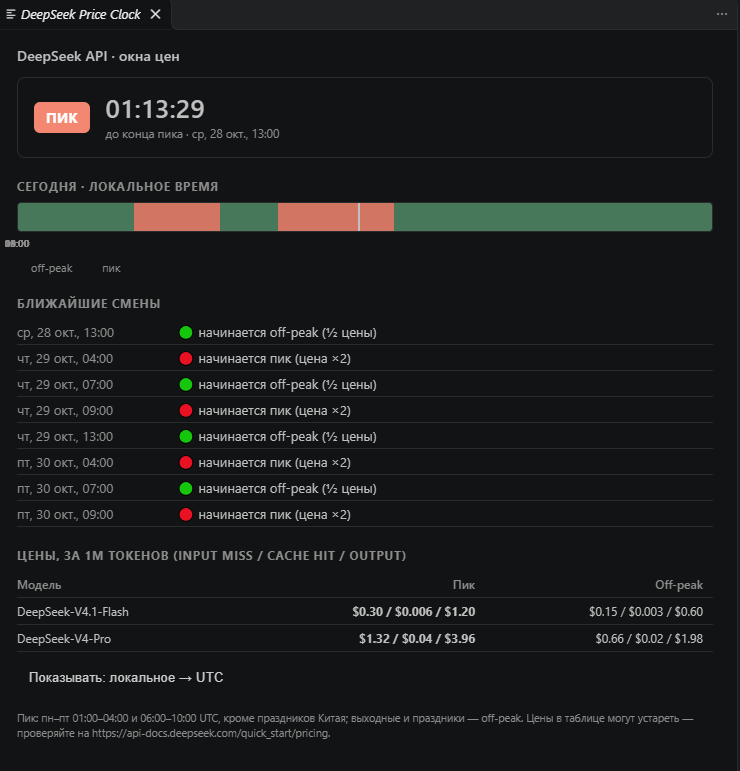
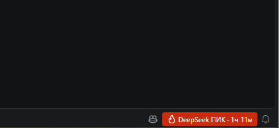
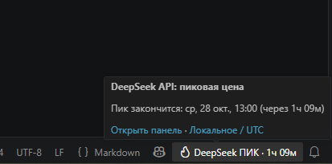
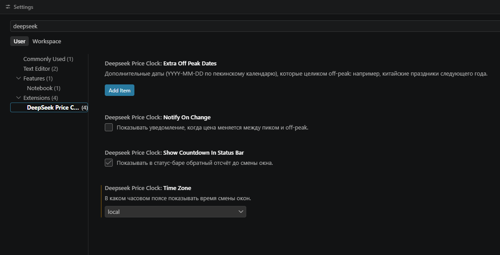

# DeepSeek Price Clock for VS Code

See at a glance whether the DeepSeek API is on **peak** or **off-peak (half-price)** pricing right now, and when the next switch happens. The status bar shows the current window with a live countdown; a dedicated panel shows the full 24-hour timeline, upcoming window changes, and current rates.

Inspired by [deepseek-price-clock](https://github.com/deepakness/deepseek-price-clock), the browser extension by [deepakness](https://github.com/deepakness), and ported to VS Code.



## Why?

DeepSeek bills API usage at two rates: off-peak is exactly half the peak rate. If you are about to start a large batch job, a long agent session, or an evaluation run, knowing whether you are in the cheap window (and how long it lasts) can noticeably cut your bill, without leaving your editor.

## Features

- **Status-bar indicator**: shows `PEAK` or `½ price` together with a countdown to the next switch. Peak is highlighted with a red background, off-peak in green. Click it to open the panel.
- **Detail panel**: live second-by-second countdown, a 24-hour timeline with a "now" marker, the next eight window changes, and a rates table for current models.
- **Holiday and weekend awareness**: weekends and Chinese public holidays are off-peak all day, and the schedule skips them automatically.
- **Local time or UTC**: show window times in your local time zone or in UTC, switchable from the panel, the status-bar tooltip, or settings.
- **Optional notifications**: get a message when the price flips between peak and off-peak (off by default).
- **Fully offline**: no API keys, no network requests. Everything is computed locally from a built-in schedule.

## Screenshots







<!-- SCREENSHOT: settings page -->


## How the schedule works

| Window | Time (UTC) | Time (Beijing, UTC+8) | Price |
| --- | --- | --- | --- |
| Peak | 01:00–04:00 and 06:00–10:00, Mon–Fri | 09:00–12:00 and 14:00–18:00 | Full rate |
| Off-peak | All other hours | All other hours | Half rate |
| Off-peak | Weekends and Chinese public holidays, all day | Same | Half rate |

Weekends and holidays are evaluated in Beijing time. The "off-peak all day" rule for weekends and holidays applies from August 23, 2026 (00:00 Beijing time); earlier dates are treated as regular days.

> **Note:** this extension shows the *pricing* window. It does not measure real-time server load or API availability, and it does not call DeepSeek in any way.

## Installation

### From a `.vsix` file

1. Build or download `deepseek-price-clock-0.1.0.vsix`.
2. In VS Code open the **Extensions** view, click the `…` menu, and choose **Install from VSIX…**, or run:

   ```bash
   code --install-extension deepseek-price-clock-0.1.0.vsix
   ```
3. Reload the window (`Ctrl+Shift+P` → **Developer: Reload Window**). The indicator appears on the right side of the status bar.

Requires VS Code 1.85 or newer.

## Commands

| Command | Description |
| --- | --- |
| `DeepSeek Price Clock: Open panel` | Opens the detail panel. |
| `DeepSeek Price Clock: Toggle local time / UTC` | Switches how window times are displayed. |

## Settings

| Setting | Default | Description |
| --- | --- | --- |
| `deepseekPriceClock.timeZone` | `local` | Show window times in local time (`local`) or UTC (`utc`). |
| `deepseekPriceClock.notifyOnChange` | `false` | Show a notification when the price switches between peak and off-peak. |
| `deepseekPriceClock.showCountdownInStatusBar` | `true` | Show the countdown to the next switch in the status bar. |
| `deepseekPriceClock.extraOffPeakDates` | `[]` | Extra dates (`YYYY-MM-DD`, Beijing calendar) that are off-peak all day, e.g. next year's Chinese public holidays. |

## Yearly maintenance

- **Chinese public holidays**: the State Council usually announces next year's schedule in November. Add the dates to the `deepseekPriceClock.extraOffPeakDates` setting, or update `CN_HOLIDAY_RANGES` in `src/price.js`.
- **Rates**: the table in the panel comes from the `RATES` array in `src/price.js`. DeepSeek has changed its prices more than once, so check it against the [official pricing page](https://api-docs.deepseek.com/quick_start/pricing).

## Development

```bash
npm install
npm test                # verifies the window logic
# press F5 in VS Code to launch an Extension Development Host
npm run package         # builds the .vsix
```

`src/price.js` contains the schedule logic with no VS Code dependency, so it can be tested in plain Node. `test/compare.test.js` checks it against the reference implementation from the original browser extension.

## Credits

- [deepseek-price-clock](https://github.com/deepakness/deepseek-price-clock) by [deepakness](https://github.com/deepakness), the original Chrome/Firefox extension whose schedule logic this project follows.
- Holiday dates are based on the Chinese State Council's yearly public holiday arrangement.

## Disclaimer

This project is not affiliated with DeepSeek. Prices and schedules are maintained by hand and may be out of date; always verify them on the official pricing page before relying on them for budgeting.

## License

[MIT](LICENSE)
